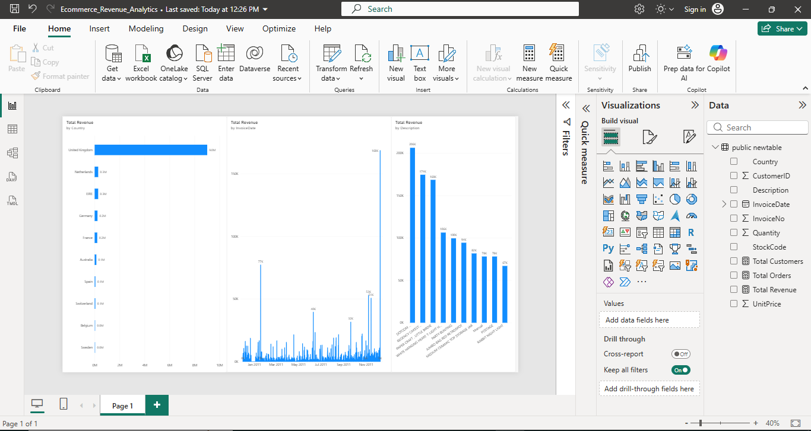

# E-Commerce Customer Analytics & Revenue Dashboard

## 📊 Project Overview
This end-to-end data analytics project processes over **532,000 transaction records** to evaluate global sales trends, identify high-value customer tiers, and surface top inventory performers. The workflow bridges **PostgreSQL** for backend data architecture and querying with **Power BI** for interactive visual reporting.

---

## 🖼️ Dashboard Preview

---

## 🛠️ Tech Stack & Tools
* **Database & Querying:** PostgreSQL, DBeaver, SQL
* **Data Visualization & BI:** Power BI Desktop, DAX
* **Analysis Techniques:** RFM Customer Segmentation, Revenue Trends, Top-N Product Filtering

---

## 📈 Key Insights & Business Outcomes
1. **Market Dominance:** The **United Kingdom** represents the overwhelming majority of sales volume and total revenue.
2. **VIP Customer Value:** The top individual customer generated **$14,646** in cumulative purchases.
3. **Product Performance:** Top-performing inventory items drive a major share of total category revenue.

---

## 📂 Files Included
* `ecommerce_analytics_queries.sql` — Full SQL script used for data aggregation and segmentation.
* `Ecommerce_Revenue_Analytics.pbix` — Power BI source dashboard file.
